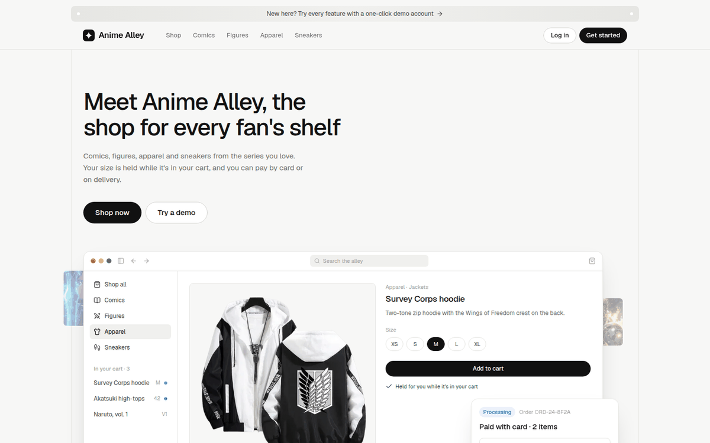
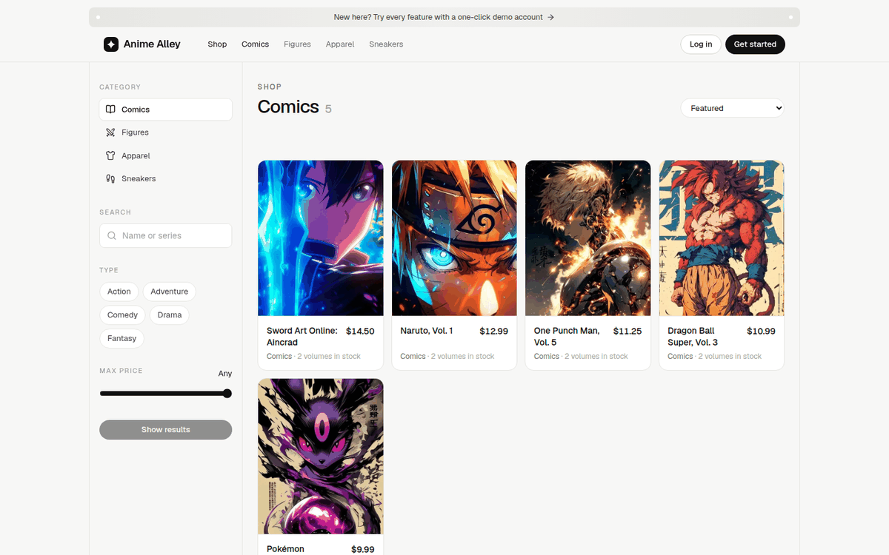
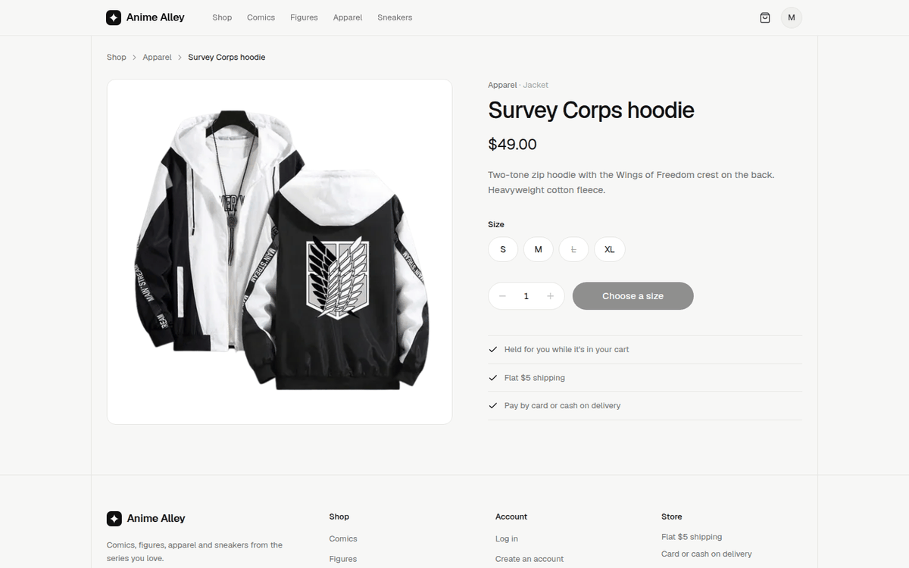
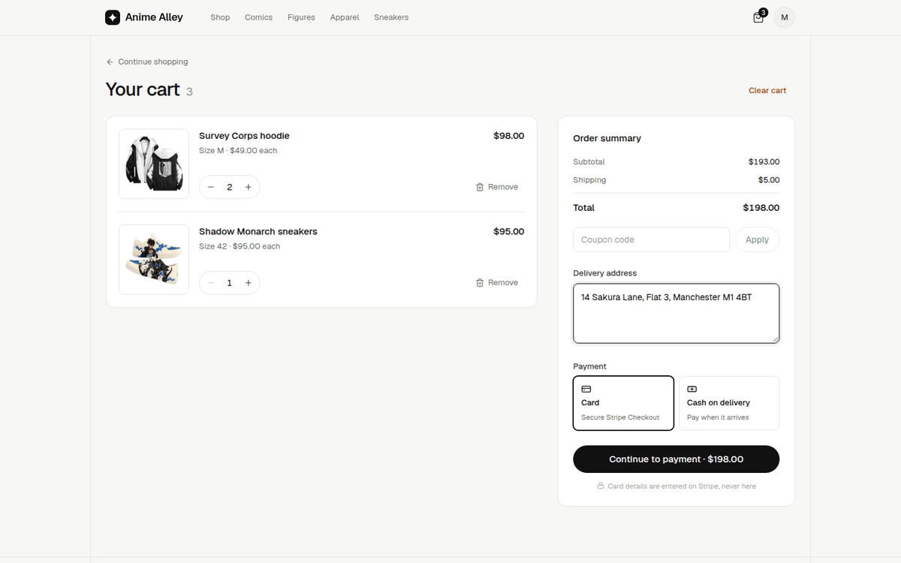
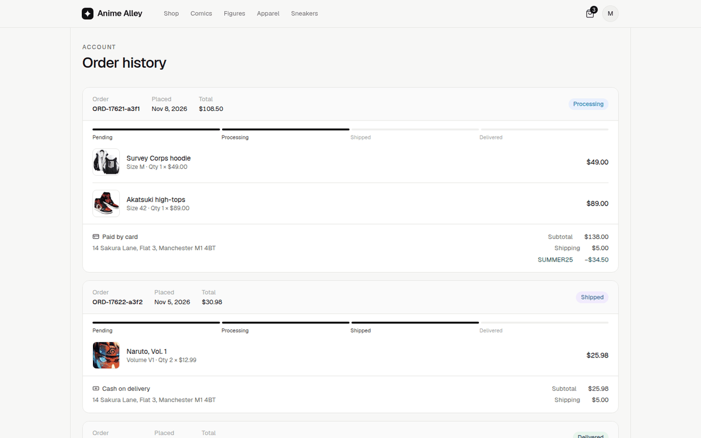
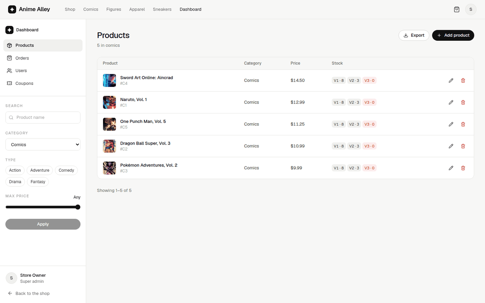
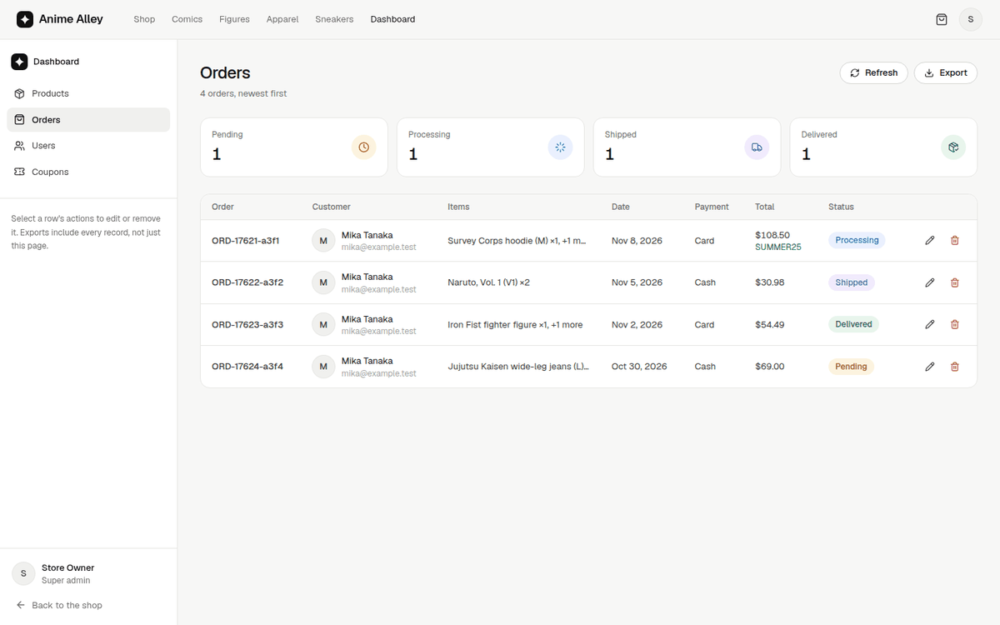
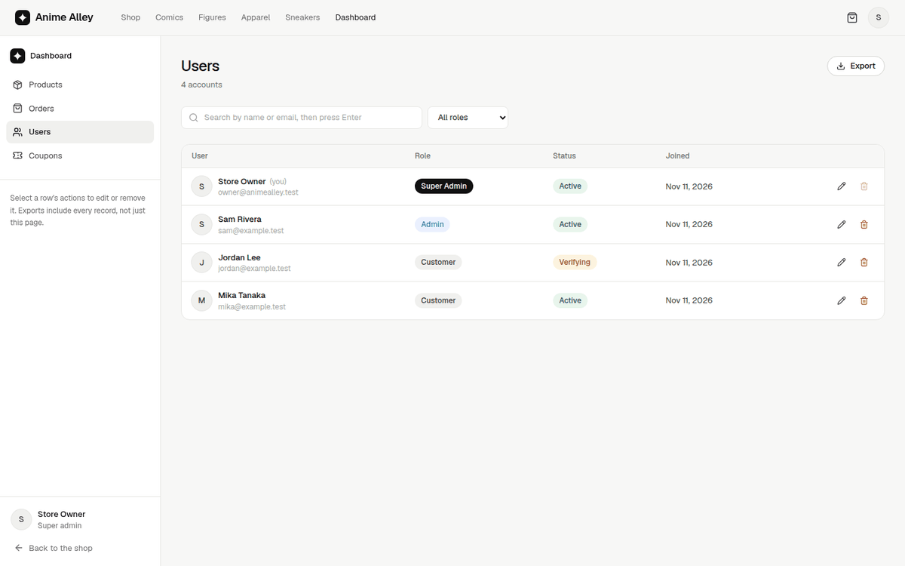
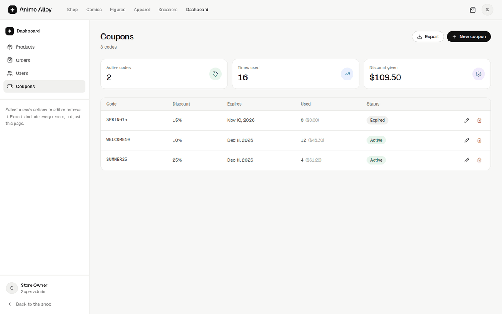

# Anime Alley

Anime Alley is a full-stack MERN e-commerce app for anime fans, with a customer storefront and an admin dashboard.

## Features

### Customer Experience

- Email/password sign-up with OTP verification and Google login
- Product browsing with search, category, type and price filters
- Stock held for you while it's in your cart, with coupon support at checkout
- Cash on Delivery and Stripe Checkout payment options
- Order history with each order's items, sizes and status
- Responsive design for desktop and mobile, with motion that respects "reduce motion"

### Admin Tools

- Manage users, products, coupons, and orders
- Update order status from the dashboard
- Export data to Excel and PDF
- One-click read-only demo admin, with customer details masked

## Screenshots

### Home Page

### Shop Page

### Product Page

### Cart and Checkout

### Order History

### Admin Dashboard - Products

### Admin Dashboard - Orders

### Admin Dashboard - Users

### Admin Dashboard - Coupons

## Tech Stack:

- **Frontend:** React 19, Redux Toolkit, Tailwind CSS 4, Motion, React Hook Form, React Router, Lucide icons, Geist font
- **Backend:** Node.js, Express 5, MongoDB with Mongoose, Passport.js, Stripe SDK, Nodemailer, Cloudinary, ExcelJS, PDFKit
- **Deployment:** Vercel
